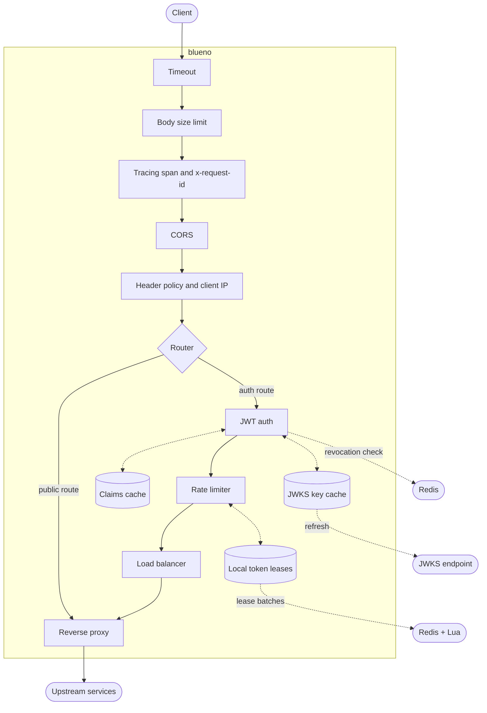

# blueno

A fast, configurable API gateway written in Rust.

blueno sits in front of your services and handles the work every service would otherwise repeat: verifying JWTs, rate limiting per user, controlling which headers reach your upstreams, capping request sizes and timing out slow calls. It is built on tokio, hyper, axum and tower, and every feature can be turned on, tuned or switched off from one TOML file.

## Features

- **JWT authentication** with an HMAC secret or a remote JWKS endpoint. Verified claims are cached, keyed by a SHA-256 hash of the token, so most requests skip signature checks. Revoked tokens are rejected in both modes, checked against Redis.
- **Distributed rate limiting** with per-role tiers. Each instance leases batches of tokens from Redis and spends them in memory, so Redis sees one call per batch instead of one per request. If Redis goes down, blueno falls back to local limits and keeps serving.
- **Pluggable rate limit script.** A Lua token bucket ships built in. Point blueno at your own script to change the algorithm.
- **Header policy** with three modes: allowlist, denylist and passthrough. Wildcards like `x-internal-*`, plus `remove`, `set` and `add` rules with variables such as `{client_ip}` and `{request_id}`.
- **Client IP forwarding.** `X-Forwarded-For`, `X-Real-IP`, `X-Forwarded-Proto`, `X-Forwarded-Host` and RFC 7239 `Forwarded`. Spoofed values are discarded unless the request comes from a trusted proxy.
- **Safe by default.** Identity headers like `x-user-id` can never be forged by clients, and hop-by-hop headers never reach upstreams.
- **Request body limit** that counts the real bytes as they stream, so a fake `Content-Length` cannot get past it.
- **Request timeouts.** Upstream calls slower than `request_timeout_secs` are cut off with a 504, so one slow service cannot hold connections open.
- **Request tracing.** Every request gets a UUIDv7 `x-request-id`, sent to the upstream and returned to the client, and runs inside an `http_request` span with its ID, method and URI. Every log line from that request carries those fields, so one ID ties a request together across the gateway and your services.
- **CORS** handled at the edge.
- **Load balancing** across backends with power-of-two-choices or round robin, health checks and a circuit breaker (Rust API).


## Architecture



Global layers wrap every request. Routes then add auth, rate limiting and load balancing depending on their config. The three in-memory caches keep the hot path local: a cached token skips signature checks, cached keys skip the JWKS endpoint, and leased tokens skip Redis.

## Quick start

Requirements: Rust 1.85 or newer, `cmake` and a C compiler (for `aws-lc-rs`). Redis is optional and only needed for token revocation and distributed rate limiting.

```bash
git clone https://github.com/swar09/blueno.git && cd blueno
cp conf/blueno.example.toml conf/blueno.toml
echo "JWT_SECRET=$(openssl rand -hex 32)" > .env
cargo run --release -- --env-file .env
```

Send a request:

```bash
curl http://localhost:8080/healthz
curl http://localhost:8080/api/v1/secure/orders -H "Authorization: Bearer <token>"
```

On authenticated routes, blueno removes the `Authorization` header and forwards the caller's identity to the upstream as `x-user-id`, `x-user-role` and `x-token-id`.

## Benchmarks

Single instance, 32 concurrent workers, 4 seconds, against local mock upstreams:

| Metric | Result |
| --- | --- |
| Throughput | 130,043 req/s |
| Latency p50 | 225 µs |
| Latency p90 | 345 µs |
| Latency p99 | 577 µs |
| Errors | 0 |

Run it yourself. The runner starts its own mock upstreams when none are running:

```bash
cargo run --release -p benchmark -- --concurrency 32 --duration-secs 4 --downstream-services 10
```

| Flag | Default | Meaning |
| --- | --- | --- |
| `-c, --concurrency` | 32 | Concurrent workers |
| `-d, --duration-secs` | 4 | Test length |
| `-s, --downstream-services` | 10 | Mock upstreams |
| `-g, --gateway-url` | | Target an already running gateway |


## Configuration

blueno loads one config file: the path given with `--config`, else the path in `BLUENO_CONFIG`, else `conf/blueno.toml`. If that file is missing, blueno stops with an error. Settings are then applied in this order, later ones winning: config file, environment variables, CLI flags.

```toml
[server]
host = "0.0.0.0"
port = 8080

[auth]
enabled = true
mode = "jwks"                      # secret | jwks | none
jwks_endpoint = "https://auth.example.com/.well-known/jwks.json"
logout_path = "/api/v1/auth/logout"

[jwt_cache]
enabled = true
ttl_secs = 15

[limits]
max_request_body_bytes = 10485760  # or "unlimited"
request_timeout_secs = 30

[[routes]]
path = "/api/v1/public"
upstream = "http://127.0.0.1:8081"
auth = false
rate_limit = false

[[routes]]
path = "/api/v1/orders"
upstream = "http://127.0.0.1:8082"
auth = true
rate_limit = true

[rate_limiter]
enabled = true
default_tier = "tier4"
# script_path = "conf/my_limiter.lua"

[rate_limiter.role_mapping]
admin = "tier1"
partner = "tier2"

[rate_limiter.tiers.tier1]
initial_tokens = 1000
fill_rate = 1000
burst_interval_secs = 60
max_tokens = 5000
lease_batch_size = 500
```

Routes match by longest path prefix. Rate limiting identifies callers by their verified JWT, so use it on routes with `auth = true`. See `conf/blueno.example.toml` for every option with its default.

### Header policy

```toml
[headers]
enabled = true
remove = ["x-powered-by"]

[headers.filter]
mode = "denylist"                  # allowlist | denylist | passthrough
names = ["cookie", "x-internal-*"]

[headers.safety]
strip_identity_headers = true
strip_hop_by_hop = true

[headers.forwarding]
x_forwarded_for = "append"         # append | replace | off
x_real_ip = true
x_forwarded_proto = true
x_forwarded_host = true
forwarded = false
trusted_proxies = ["10.0.0.0/8"]

[[headers.set]]
name = "x-client"
value = "{client_ip}:{client_port}"

[[headers.add]]
name = "x-gateway"
value = "blueno"
```

Rules run in a fixed order: filter, `remove`, forwarding headers, `set`, `add`. Available variables are `{client_ip}`, `{client_port}`, `{request_id}`, `{scheme}`, `{host}` and `{method}`. Mistakes such as an unknown variable or a reserved header name stop blueno at startup with a clear error, never at request time.

The default is an allowlist of common headers, so nothing unexpected reaches your services until you open it up.

### Secrets


| Variable | Purpose |
| --- | --- |
| `JWT_SECRET` / `JWT_SECRET_FILE` | HMAC key for `mode = "secret"` |
| `REDIS_URL` / `REDIS_URL_FILE` | Redis for token revocation, password included |
| `RATE_LIMIT_REDIS_URL` / `RATE_LIMIT_REDIS_URL_FILE` | Redis for the rate limiter |

For local work, keep them in `.env` and start with `--env-file .env`. Variables already set in the shell always win over the file. A template lives in `.env.example`.

### Environment overrides

| Variable | Overrides |
| --- | --- |
| `BLUENO_CONFIG` | Config file path |
| `BLUENO_ENV_FILE` | `.env` file path |
| `SERVER_HOST`, `SERVER_PORT` | `[server]` |
| `AUTH_ENABLED`, `AUTH_MODE`, `JWKS_ENDPOINT` | `[auth]` |
| `REQUEST_TIMEOUT_SECS`, `MAX_REQUEST_BODY_BYTES` | `[limits]` |
| `RATE_LIMIT_ENABLED`, `RATE_LIMIT_SCRIPT_PATH` | `[rate_limiter]` |
| `RATE_LIMIT_LEASE_DURATION_SECS`, `RATE_LIMIT_BATCH_WINDOW_MICROS` | `[rate_limiter]` |
| `JWT_CACHE_ENABLED`, `JWT_CACHE_TTL_SECS` | `[jwt_cache]` |

## Command line

```text
blueno [options]

  -c, --config <file>            configuration file
      --env-file <file>          load a .env file
      --host <host>              bind host
  -p, --port <port>              bind port
      --auth <bool>              enable or disable authentication
      --no-auth                  disable authentication
      --auth-mode <mode>         secret | jwks | none
      --jwks <url>               JWKS endpoint
      --logout-path <path>       logout endpoint path
      --redis <url>              Redis URL for auth
      --rate-limit <bool>        enable or disable rate limiting
      --rate-limit-script <file> custom Lua script
  -h, --help                     print help
```

## Token revocation

To revoke a token, write its `jti` to the Redis at `REDIS_URL` with an expiry matching the token's remaining lifetime:

```bash
redis-cli SET blacklist:<jti> <jti> EX <seconds-until-exp>
```

blueno checks this key whenever it verifies a token, in both `secret` and `jwks` mode. A verified token is then cached for `jwt_cache.ttl_secs`, so a revocation takes effect within that window. Keep the TTL short if revocations must apply instantly. Calling the configured `logout_path` drops the caller's token from the cache right away.

If Redis is unreachable at startup, blueno logs a warning and runs without revocation checks. If Redis fails later, tokens that need verification are rejected rather than let through.

## Custom rate limit script

The built-in script is `conf/rate_limit.lua`, compiled into the binary. To replace it, set `script_path` or `--rate-limit-script`. Your script receives:

```text
KEYS[1]  <key_prefix>:user:<uuid>
ARGV     initial_tokens, fill_rate, burst_interval_secs, max_tokens, lease_batch_size, ttl
returns  { granted, retry_after_secs }
```

If the script errors at runtime, blueno switches to its in-memory limiter for five seconds and retries Redis after that.

## Responses

| Status | When |
| --- | --- |
| 401 | Missing, invalid, expired or revoked token |
| 413 | Request body over `max_request_body_bytes` |
| 429 | Rate limit reached, with `retry-after` and `x-ratelimit-*` headers |
| 502 | Upstream unreachable |
| 504 | Upstream slower than `request_timeout_secs` |


## Development

```bash
./scripts/check.sh         # build, fmt, clippy, tests
./scripts/check.sh --fix   # apply fixes first
```

## License

MIT. See [LICENSE](LICENSE).

## Why "blueno"?

Blueno is a CP9 agent in One Piece who ate the Door-Door Fruit. He can open a door anywhere, even in thin air, and step straight through to where he needs to be. That is the job of a gateway: one door in front of your services that sends each request exactly where it belongs.
